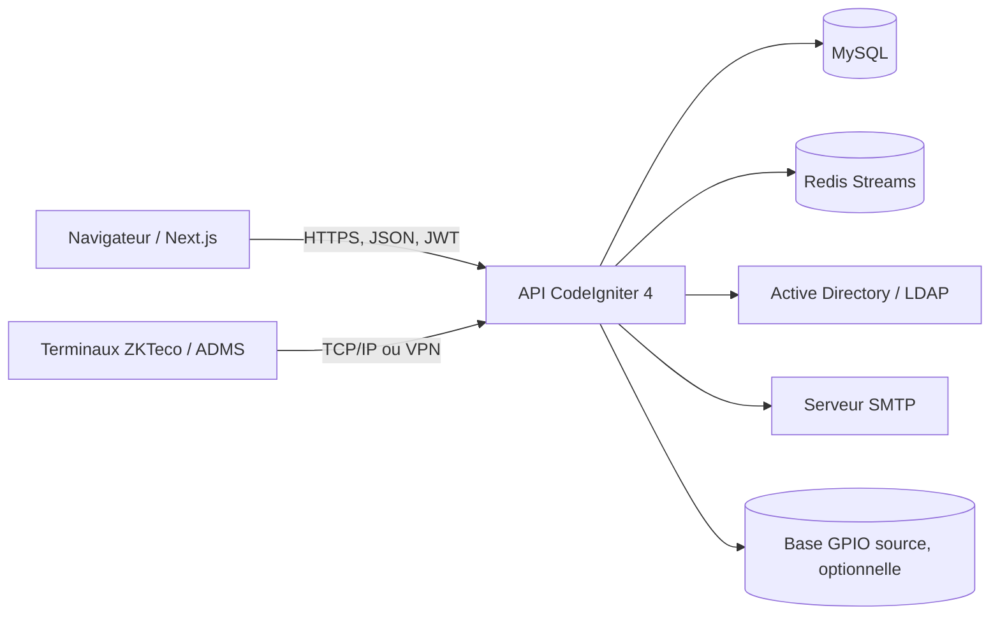

# AMS — Gestion des présences

AMS est une application de gestion des employés et de leurs présences, conçue pour plusieurs organisations (tenants). Le backend expose une API REST CodeIgniter 4 et reçoit les pointages des terminaux ZKTeco; le frontend est une application Next.js.

> Ce dépôt est le backend (`ams`). Le frontend est dans le dépôt frère `ams-frontend`. Les configurations de serveur et Docker sont des consignes de déploiement, pas des artefacts déjà fournis.

## Architecture



| Composant | Technologies |
|---|---|
| Backend | PHP 8.2+ (PHP 8.4 recommandé), CodeIgniter 4.7, Composer |
| Frontend | Node.js 20+, Next.js 16, React 19, TypeScript |
| Base applicative | MySQL 8 / InnoDB |
| Terminaux | ZKTeco, accès direct ou push ADMS |

## Prérequis

- PHP 8.2+ et extensions `intl`, `mbstring`, `mysqli`/`mysqlnd`, `curl`, `json`, `openssl`, `fileinfo`, `gd` et `zip` selon les fonctionnalités activées.
- Composer 2.
- MySQL 8 et une base dédiée à AMS.
- Redis accessible depuis le backend pour la diffusion temps réel des pointages.
- Node.js 20+ et npm pour le frontend.
- Accès réseau aux services LDAP, SMTP, GPIO ou aux terminaux seulement si ces intégrations sont activées.

## Installation locale

### Backend

Depuis le répertoire `ams` :

```powershell
Copy-Item env .env
composer install
```

Configurez `.env` (voir [Configuration](#configuration)), puis appliquez les migrations et démarrez le serveur de développement :

```powershell
php spark migrate
php spark serve --host 127.0.0.1 --port 8080
```

L’API est alors disponible sur `http://127.0.0.1:8080`. Le serveur `spark serve` est destiné au développement, pas à la production.

### Frontend

Dans le dépôt frère `ams-frontend` :

```powershell
npm ci
Copy-Item .env.example .env.local
```

Renseignez `NEXT_PUBLIC_API_URL` dans `.env.local`, puis lancez :

```powershell
npm run dev
```

L’interface de développement Next.js est généralement disponible sur `http://localhost:3000`.

## Configuration

Le fichier `.env` du backend ne doit jamais être commité. Les clés sont des exemples; utilisez des secrets générés et un compte MySQL à privilèges minimaux.

```ini
CI_ENVIRONMENT = development
app.baseURL = 'http://localhost:8080/'

database.default.hostname = localhost
database.default.database = ams
database.default.username = ams_app
database.default.password = 'REMPLACER'
database.default.DBDriver = MySQLi
database.default.port = 3306

JWT_SECRET = 'REMPLACER_PAR_UN_SECRET_ALEATOIRE_D_AU_MOINS_32_CARACTERES'
JWT_TTL = 3600

REDIS_HOST = 127.0.0.1
REDIS_PORT = 6379
REDIS_DATABASE = 0
```

Après la première connexion, configurez LDAP dans **Paramètres → Connexion LDAP** pour le tenant courant. Les réglages SMTP et GPIO/ETau, ainsi que l’activation de la synchronisation OBR, se trouvent dans **Paramètres → Intégrations** (super-administrateur uniquement). Les anciennes valeurs `.env` peuvent être préremplies; enregistrez-les dans l’interface pour les conserver en base.

Le bouton de test SMTP vérifie uniquement l’ouverture de la connexion au serveur et ne transmet aucun courriel. Si un test d’envoi de message est exceptionnellement nécessaire, son destinataire doit être exclusivement `ezechiel.niyorurema@obr.gov.bi`; ne lancez pas ce test vers d’autres adresses.

Les mots de passe SMTP, GPIO et LDAP sont chiffrés en base. Une clé dédiée est créée dans `writable/keys/integration-settings.key` lors du premier enregistrement d’un secret. Sauvegardez cette clé séparément et protégez-la comme un secret : les valeurs chiffrées ne pourront pas être relues sans elle. La base source GPIO doit rester en lecture seule; AMS écrit uniquement dans sa propre base. La base AMS, Redis, les clés JWT et les autres paramètres de démarrage restent des paramètres d’infrastructure et ne sont pas modifiables depuis l’application.
- Temps réel : `REDIS_HOST`, `REDIS_PORT`, `REDIS_DATABASE` et, si nécessaire, `REDIS_PASSWORD`. Le serveur Redis doit être accessible par le backend.
- Frontend : `NEXT_PUBLIC_API_URL`, URL publique du backend; cette valeur est exposée au navigateur.

Ne mettez jamais de mots de passe, clés LDAP/SMTP ou données de production dans les fichiers d’exemple, les tests ou les captures.

## Commandes utiles

```powershell
php spark
php spark migrate:status
php spark migrate
php spark routes
php vendor/bin/phpunit --no-coverage tests/unit
php vendor/bin/phpunit --no-coverage tests
```

Les commandes applicatives incluent notamment :

| Commande | Usage |
|---|---|
| `auth:test-ldap {tenant_id}` | Tester la connexion LDAP du tenant |
| `auth:sync-ldap-users {tenant_id}` | Synchroniser les comptes LDAP |
| `auth:purge-logs` | Purger les anciens journaux d’authentification |
| `unites:importer {fichier}` | Importer la hiérarchie depuis CSV |
| `horaires:creer-defaut {tenant_id}` | Créer les horaires standards |
| `capteurs:sync-employes {capteur_id}` | Lire les utilisateurs du terminal |
| `capteurs:sync-pointages {capteur_id}` | Synchroniser les pointages |
| `capteurs:sync-users {capteur_id}` | Synchroniser les comptes du terminal |
| `capteurs:sync-attendance {capteur_id}` | Synchronisation historique des présences |
| `affectations:sync-capteur {capteur_id}` | Synchroniser les affectations vers le terminal |
| `gpio:sync-obr --dry-run` | Simuler la synchronisation des employés, unités et mandats du tenant OBR |
| `gpio:sync-obr` | Appliquer la synchronisation si elle est activée dans Paramètres → Intégrations |
| `capteurs:scan [capteur_id]` / `capteurs:scan-all` | Scanner un ou plusieurs terminaux |
| `rapports:envoyer-quotidiens` | Envoyer les rapports planifiés quotidiens |
| `rapports:envoyer-hebdomadaires` | Envoyer les rapports planifiés hebdomadaires |
| `rapports:envoyer-mensuels` | Envoyer les rapports planifiés mensuels |
| `system:jobs:process-retries` | Traiter jusqu’à 20 demandes de relance approuvées, mises en file par un super-administrateur |
| `system:jobs:prune-history [jours]` | Purger les exécutions terminées au-delà de 90 jours (minimum : 30 jours) |
| `adms:status`, `adms:diagnostic`, `adms:check-ready` | Diagnostiquer la réception ADMS |
| `pointages:recalculer-journee {date} --tenant=X [--employe=Y]` | Recalculer les projections quotidiennes |
| `demo:bout-en-bout` | Démonstration opt-in sur le tenant isolé DEMO |
| `demo:nettoyer [--force]` | Nettoyer les données du tenant DEMO après confirmation |

### Synchronisation planifiée ETau (tenant OBR)

La commande `gpio:sync-obr` lit `etau_utilisateur`, la hiérarchie ETau et `etau_service_chef`, puis synchronise employés, comptes lecteurs et mandats dans le tenant AMS `1`. Elle ne supprime ni ne réactive automatiquement les employés archivés dans AMS. Les tenants différents de `1` ne sont jamais synchronisés depuis GPIO.

Avant l’activation, configurez l’authentification LDAP/HYBRIDE du tenant OBR, enregistrez les paramètres GPIO dans **Paramètres → Intégrations**, testez la connexion, puis exécutez `php spark gpio:sync-obr --dry-run`. Activez ensuite la synchronisation dans l’interface et planifiez `php spark gpio:sync-obr` via le planificateur système (par exemple Windows Task Scheduler ou cron) à la fréquence voulue. Le planificateur système doit toujours être installé côté serveur; l’application contrôle l’activation à chaque exécution. Un verrou en base refuse les exécutions simultanées.

En simulation, les phases d’affectations et de mandats ne voient pas les employés qui seraient créés; leurs compteurs « introuvable » sont donc recalculés lors de l’application.

Chaque employé importé ou créé par l’API reçoit un compte AMS lié, avec le rôle `lecteur`; les comptes existants et leurs rôles ne sont pas remplacés. Un employé AMS non encore lié est adopté uniquement si son matricule correspond de façon unique; son profil existant n’est pas réécrit pendant cette première liaison, puis les synchronisations suivantes appliquent les mises à jour ETau. Sans email ETau, le compte est créé sans email ni mot de passe local. Au premier login LDAP sous son matricule, AMS valide l’identité auprès de LDAP, lie uniquement un compte lecteur ETau correspondant de façon unique, puis enregistre l’email LDAP sur le compte et le dossier employé. Les mots de passe LDAP ne sont jamais copiés dans AMS.

Consultez `php spark <commande> --help` avant d’exécuter une commande sur une installation réelle. Les commandes de synchronisation contactent des équipements ou systèmes externes.
Le seeder `php spark db:seed DemoAttendanceRules` crée le tenant isolé DEMO (id 999), y copie 90 pointages et prépare ses contrats/créneaux. Il ne modifie pas le tenant source 1.

Le rapport J-1 se configure dans **Rapports → Rapport automatique J-1** : l’heure par défaut est 08:00 et est évaluée dans le fuseau du tenant; les jours d’envoi suivent `tenants.jours_travailles`. L’interrupteur **Envoi des rapports activé** est le verrou serveur pour tous les courriels de rapport du tenant, planifiés ou manuels; désactivé ou sans configuration enregistrée, aucun courriel de rapport n’est envoyé. Les rapports J-1 sont préparés avec le même destinataire, la même date et le même périmètre pour l’aperçu et l’envoi. Les mandats actifs des superviseurs, chefs de service, directeurs et commissaires reçoivent le rapport de leur unité et de ses sous-unités; des destinataires supplémentaires peuvent être sélectionnés. L’onglet **Rapports J-1 à consulter avant envoi** permet de vérifier le destinataire et le contenu détaillé du rapport sans envoyer de courriel; un superviseur ne voit que ses propres rapports, tandis que les administrateurs/RH du tenant voient la liste du tenant. Aucun envoi automatique n’est effectué lorsque le jour d’exécution n’est pas travaillé ou lorsque J-1 est un jour férié. Les anciennes lignes quotidiennes de `rapports_planifies` sont conservées mais ne sont plus exécutées par la commande quotidienne, qui utilise uniquement le mécanisme J-1 par tenant. Les commandes hebdomadaires et mensuelles restent distinctes pour leur fréquence, mais leur envoi et celui des courriels manuels sont soumis au même interrupteur. Les envois utilisent le transport SMTP déjà configuré pour AMS et leur contenu est conservé dans l’historique de l’application. Le planificateur système doit exécuter régulièrement `php spark rapports:envoyer-quotidiens` à partir de l’heure configurée.

Le panneau super-administrateur **Paramètres → Intégrations** suit les exécutions des rapports, de GPIO et des capteurs. Planifiez aussi `php spark system:jobs:process-retries` (par exemple chaque minute) pour traiter les relances mises en file. Le bouton de relance ne lance pas la tâche immédiatement; le traitement d’une relance de rapport peut envoyer de vrais courriels aux destinataires configurés.

Les rapports J-1 enregistrent dans l’exécution la date, la configuration, le format, la langue, l’éligibilité du jour et les identifiants des destinataires/périmètres. Une relance reprend ce contexte original; les archives déjà envoyées sont ignorées. Une relance partielle garde son état `PARTIAL`. Les exécutions terminées sont conservées 90 jours par défaut; planifiez la purge mensuelle et gardez une sauvegarde conforme à la politique institutionnelle avant toute réduction de cette durée.

### Temps réel des pointages

Le scanner doit fonctionner pour interroger périodiquement les terminaux (par exemple `php spark capteurs:scan-all --interval=5`). À chaque nouveau pointage inséré et reclassé, le backend publie un événement dans le flux Redis propre au tenant. La latence comprend donc l’intervalle de scan et le temps de réponse du terminal; SSE ne peut pas recevoir un pointage que le scanner n’a pas encore collecté.

La page Pointages ouvre un flux SSE authentifié à `GET /api/realtime/pointages`, avec le JWT dans l’en-tête `Authorization` (pas dans l’URL). Le flux se ferme après environ 22 secondes puis reprend avec le dernier identifiant d’événement. Redis conserve approximativement les 2 000 événements récents de chaque tenant. Si Redis est indisponible, l’insertion en base reste réussie et l’échec de diffusion est journalisé.

Le curseur SSE est aussi conservé pendant la session navigateur afin de reprendre après une fermeture/reconnexion de la page. La synchronisation des capteurs utilise `dernier_pointage_sync` comme borne et déduplique les événements déjà enregistrés; après une indisponibilité du scanner, les pointages conservés sur le capteur sont récupérés au prochain scan, sous réserve que leurs horodatages soient postérieurs au dernier checkpoint.

L’action « Recalculer » sur un pointage appelle `POST /api/pointages/{id}/recalculer`. Elle affiche le résultat recalculé à partir des autres pointages du jour et de l’horaire applicable, mais ne modifie aucune ligne. Le formulaire de création manuelle utilise `POST /api/pointages`; les permissions de périmètre sont imposées côté backend.

Sur la page Pointages, CSV et Excel (.xlsx) exportent les filtres actifs. Les filtres s’appliquent dès leur changement; le type du graphique d’évolution est mémorisé dans les préférences du navigateur.

## Tests

- Tests unitaires/backend : `php vendor/bin/phpunit --no-coverage tests/unit`.
- Tests d’intégration API : voir [tests/e2e/README.md](./tests/e2e/README.md) et le script PowerShell. Ils créent un tenant temporaire; utilisez une base de test et un super-admin de test.
- Frontend : depuis `ams-frontend`, `npx tsc --noEmit`, `npm run lint` et `npm run build`.

## Documentation

- [Contrat API](./docs/API.md)
- [Schéma et migrations SQL](./docs/DATABASE.md)
- [Déploiement et opérations](./docs/DEPLOYMENT.md)
- [Diagnostic des capteurs](./docs/DIAGNOSTIC_CAPTEUR.md)
- [Validation manuelle des règles de pointage](./docs/VALIDATION_MANUELLE_POINTAGE.md)
- [Historique](./CHANGELOG.md)

## Sécurité et multi-tenant

Chaque utilisateur et chaque ligne métier appartient à un `tenant_id`. L’API obtient le tenant du JWT et doit maintenir le filtre tenant dans toutes les lectures et écritures. Les endpoints `api/admin/tenants` sont réservés au super-administrateur. Les mots de passe sont stockés sous forme de hash; les jetons expirent selon `JWT_TTL`. Le filtre JWT refuse les comptes et tenants inactifs.

Rôles applicatifs : `super_admin` (indicateur global), `admin`, `rh`, `superviseur`, `chef_service`, `directeur`, `commissaire`, `lecteur`. Les autorisations restent basées sur les rôles; un système générique de permissions granulaires n’est pas livré.

## Déploiement

Les instructions de production (HTTPS, Apache/Nginx, MySQL, sauvegardes et recommandations Docker) sont décrites dans [docs/DEPLOYMENT.md](./docs/DEPLOYMENT.md). Aucun Dockerfile/Compose ni pipeline CI/CD n’est actuellement livré dans ce dépôt.
