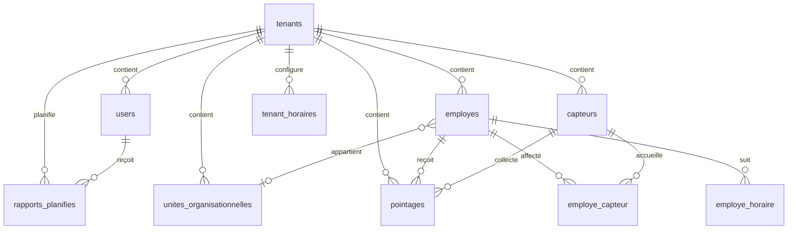

# Base de données AMS

## Conventions

- SGBD visé : MySQL 8 / InnoDB.
- Les identifiants métier sont généralement des `INT UNSIGNED`; les pointages et journaux utilisent des `BIGINT UNSIGNED`.
- Les données métier sont isolées par `tenant_id`.
- Les tables gérées par des modèles CI4 peuvent utiliser `created_at`, `updated_at`, `deleted_at`; la suppression logique dépend du modèle et de la table.
- Les clés étrangères et index sont déclarés dans les migrations. Les index d’unicité des employés/appareils sont souvent tenant-scoped.

## Tables métier présentes dans les migrations

Le chiffre « 11 tables » ne correspond pas à l’état courant des migrations. Les migrations actuelles créent **14 tables métier**, en plus de la table de versionnement des migrations CI4; ce nombre peut différer d’une base ancienne ou personnalisée.

| Table | Champs structurants (en plus de `id` et des timestamps indiqués par la migration) | Relations principales |
|---|---|---|
| `tenants` | `name`, `slug`, `database_name`, `timezone`, `is_active`, `contact_email`, `logo_url`, `auth_mode`, couleurs/polices, `deleted_at` | Racine du périmètre |
| `users` | `tenant_id`, `employe_id`, `email`, `password_hash`, `nom_complet`, `telephone`, `role`, `is_super_admin`, `is_active`, `auth_source`, `derniere_connexion`, attributs LDAP, `deleted_at` | `tenant_id → tenants`; `employe_id → employes` |
| `capteurs` | `tenant_id`, `nom`, `numero_serie`, `adresse_ip`, `port`, `type_reseau`, `com_key`, firmware/platform, statut et timestamps de synchronisation | `tenant_id → tenants` |
| `employes` | `tenant_id`, `unite_id`, `matricule`, `badge_id`, identifiants capteur, nom/prénom, coordonnées, dates RH, enrôlement biométrique et `actif` | Tenant; unité selon migration |
| `pointages` | `tenant_id`, `employe_id`, `badge_id`, `capteur_id`, `type_evenement`, `date_pointage`, heure locale, `source`, `statut`, données brutes | Tenant, employé et capteur |
| `sync_logs` | `tenant_id`, `capteur_id`, `type_operation`, `statut`, message/détails, compteurs utilisateurs/pointages, durée | Tenant et capteur facultatif |
| `unites_organisationnelles` | `tenant_id`, `parent_id`, nom/code/type/niveau, adresse/contacts, responsable, ordre, actif | Tenant, parent unité, employé responsable |
| `employe_capteur` | `tenant_id`, `employe_id`, `capteur_id`, `badge_id`, actif, dates d’affectation/retrait, état de synchro | Tenant, employé, capteur |
| `tenant_horaires` | `tenant_id`, nom, plages JSON, jours travaillés, seuils d’heures, défaut, période, actif | Tenant |
| `employe_horaire` | `tenant_id`, `employe_id`, `horaire_id`, dates de début/fin | Tenant, employé et horaire |
| `rapports_planifies` | `tenant_id`, `user_id`, nom, type/fréquence, heure, jours, format/langue, périmètre/unité, actif, dernier envoi | Tenant, utilisateur, unité facultative |
| `rapports_envoyes` | `tenant_id`, planification facultative, utilisateur, date/heure, format, chemin, destinataire, statut et erreur | Tenant, planification facultative, utilisateur |
| `auth_logs` | `tenant_id`, `user_id` facultatif, email, source, statut, IP, user-agent, message d’erreur, date | Tenant et utilisateur facultatif |
| `unit_chefs` | `tenant_id`, `unite_id`, `user_id`, type de mandat, période, actif, provenance et remarque | Tenant, unité, utilisateur |
| `application_settings` | Clé/valeur des réglages globaux d’intégration, indicateur de chiffrement, auteur et timestamps | Réglages système; les valeurs sensibles sont chiffrées |

Les migrations sont la source de vérité pour toutes les colonnes, contraintes et valeurs d’ENUM. Consultez le fichier de migration correspondant avant toute modification de schéma.

Les mots de passe ne doivent contenir que des hashes `password_hash`; `com_key`, les secrets SMTP/LDAP et `raw_data` doivent être protégés comme données sensibles selon les politiques d’exploitation.

## Import GPIO (OBR)

Les paramètres de connexion GPIO/ETau sont enregistrés dans `application_settings` depuis **Paramètres → Intégrations**. Les secrets SMTP et GPIO y sont chiffrés, et le secret LDAP chiffré est stocké dans la configuration du tenant. La clé de chiffrement dédiée se trouve dans `writable/keys/integration-settings.key` et doit être sauvegardée séparément de la base. Le service d’import n’exécute que des lectures sur GPIO; les écritures éventuelles sont limitées à AMS.

La commande `php spark gpio:importer --tenant=1` est en simulation par défaut. Les étapes disponibles sont `hierarchie`, `chefs`, `employes` et `all`. L’étape employés ne traite que les lignes `etau_utilisateur` dont `typeObjet='U'`, puis rapproche les employés AMS par identifiant source, matricule ou identifiant de capteur; elle ne crée pas d’employés. L’étape chefs exige en plus un compte AMS lié à l’employé. Les motifs d’exclusion sont agrégés dans le rapport, avec au plus dix exemples.

`php spark gpio:creer-comptes-chefs --tenant=1` simule par défaut la création idempotente des comptes chefs. Les emails GPIO syntaxiquement valides sont conservés et configurés pour LDAP; un email absent devient `NULL` avec une authentification locale sans mot de passe. Le schéma doit donc avoir appliqué la migration `AllowNullEmailInUsers` avant `--apply`. Si le tenant n’est pas en mode LDAP ou HYBRIDE, l’application avec des comptes LDAP est refusée par défaut; `--allow-local-auth-mode` permet de créer explicitement ces comptes, mais ils ne pourront pas s’authentifier tant que le tenant reste en mode LOCAL. Aucun secret ni email individuel ne doit être affiché.

`php spark gpio:chercher-emails-ad --tenant=1` parcourt par pages les comptes AD correspondant au filtre `(&(objectClass=user)(mail=*@obr.gov.bi))`, puis rapproche les résultats aux emails manquants AMS d’abord par matricule exact (`employeeID` configuré ou `employeeNumber`), puis par tokens de nom/prénom normalisés sans tenir compte de l’ordre, des accents ou des noms composés. Seules les correspondances uniques sont retenues; ambiguïtés, emails invalides et conflits sont ignorés. La commande est en dry-run par défaut; utilisez `--apply` seulement après validation du résumé. Elle n’affiche aucun nom ou email individuel. Elle exige un serveur, une base de recherche et un compte de service LDAP configurés.

`php spark auth:diagnostiquer-base-ldap 1` vérifie en lecture seule le bind, la base LDAP configurée et les naming contexts retournés par le RootDSE.

`php spark tenant:configurer-auth 1 --mode=HYBRIDE` affiche le changement sans l’appliquer; ajoutez `--apply` pour le modifier. Testez d’abord LDAP avec `php spark auth:test-ldap 1`. En mode HYBRIDE, l’application tente LDAP puis l’authentification locale; un compte sans email et sans mot de passe reste inutilisable.

`php spark gpio:investiguer-chefs-manquants --tenant=1` affiche seulement les nombres agrégés d’employés sans correspondance AMS; aucun nom ni matricule n’est affiché.

`php spark gpio:investiguer-emails-manquants --tenant=1` détaille localement les comptes de chef restés sans email avec matricule, nom et unités, en les classant par ambiguïté ou absence de correspondance AD. La commande est en lecture seule et n’affiche aucun email AD ni mot de passe.

`php spark gpio:lister-emails-manquants --tenant=1` est l’alias de ce diagnostic détaillé. Les consignes d’authentification et le test AD sans affichage des identifiants sont dans [AUTHENTIFICATION.md](./AUTHENTIFICATION.md); le script `php scripts/test-connexion-chef.php` vérifie seulement l’existence d’une adresse active dans AD, pas le mot de passe de la personne.

`php spark pointages:analyser-horaires --tenant=1` affiche des agrégats de pointages par statut, type, heure et mois, ainsi que leur proximité avec les références de l’horaire par défaut. Cette analyse est en lecture seule et ne recommande ni n’applique seule un changement de tolérance.

`php spark pointages:simuler-plages-horaires --tenant=1` compare en lecture seule le classement historique par position au classement expérimental chronologique sur les heures de référence des plages, pour plusieurs tolérances. Ce résultat est exploratoire : une reclassification réelle exige une validation métier séparée.

Pour la hiérarchie, les codes sont composés à partir du code source et du code composé du parent; les codes source identiques sous le même parent reçoivent un sigle du nom pour les distinguer. `php spark gpio:analyser-conflits --tenant=1` détaille les codes sources répétés. `php spark gpio:diagnostiquer-associations --tenant=1`, `php spark gpio:diagnostiquer-chefs --tenant=1` et `php spark gpio:comparer-matricules --tenant=1` mesurent les correspondances sans afficher de données nominatives. Vérifiez le résumé du dry-run avant d’utiliser explicitement `--apply`; un import avec erreurs est annulé dans AMS. `--json` affiche un rapport structuré, et `--dry-run` peut être indiqué explicitement.

## Relations



Certaines relations sont représentées par `tenant_id` ou par des tables d’affectation, et les index composites veillent à ce que les lectures fréquentes commencent par le tenant et les dimensions de filtrage.

## Index et contraintes remarquables

- `tenants.slug` unique.
- `users(tenant_id, email)` unique; les comptes de tenants différents peuvent réutiliser une adresse selon le schéma.
- `employes(tenant_id, matricule)` et `employes(tenant_id, badge_id)` uniques.
- `capteurs(tenant_id, nom)` et `(tenant_id, adresse_ip, port)` uniques.
- `pointages(tenant_id, date_pointage)`, `(tenant_id, badge_id, date_pointage)` et indexes capteur/statut.
- Les tables de rapports et d’affectations indexent fréquemment `(tenant_id, ...)`.

Pour connaître la définition exacte sur une installation :

```sql
SHOW TABLES;
SHOW CREATE TABLE users;
SHOW INDEX FROM pointages;
```

## Migrations

Les migrations versionnées se trouvent sous `app/Database/Migrations`. La séquence actuelle couvre la création des tenants, utilisateurs, capteurs, employés, pointages et journaux de synchronisation, puis les unités, affectations, horaires, rapports, LDAP, journaux d’authentification, responsables d’unité, apparence et rôles étendus.

```powershell
php spark migrate:status
php spark migrate
```

Sauvegardez la base avant une mise à jour. Le rollback n’est pas toujours sans perte; la migration d’extension des rôles refuse notamment de réduire l’ENUM si des comptes utilisent des rôles plus récents.

La table `migrations` de CodeIgniter est une table technique distincte des 14 tables métier décrites ci-dessus. Les environnements peuvent aussi avoir d’autres tables ajoutées localement ou par intégration externe.
